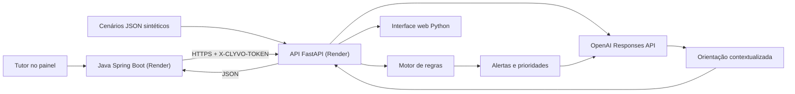

# Arquitetura publicada — CLYVO Elo AI | Sprint 4

A integração Java + Python foi demonstrada em serviços Render publicados em contas distintas, inclusive com `OPENAI_RESPONSES_API` nas orientações para a Pipoca.

- **Autenticação:** o Java mantém as restrições de acesso ao pet e envia o token no backend; o Python valida `X-CLYVO-TOKEN`. A chave OpenAI permanece no Python.
- **Dados no Java:** pet e evento clínico vêm do banco da clínica; leituras dos sensores são inseridas manualmente para demonstração.
- **Cenários Python:** arquivos JSON sintéticos Lara, Zakaria e Bolt, sem sensores físicos nem persistência de leituras no Python.
- **Responsabilidades:** regras determinísticas classificam alertas; LLM gera texto. Não representa diagnóstico veterinário.

API Python: https://clyvo-elo-ai-python.onrender.com · Painel Java: https://clyvo-elo-java.onrender.com
