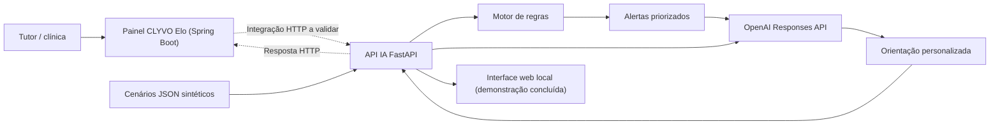

# Arquitetura — CLYVO Elo AI Sprint 4

**Legendas:** linhas contínuas = fluxos implementados e demonstrados no serviço Python; linhas pontilhadas = integração Java ainda pendente de execução/validação. Sensores físicos e persistência em banco **não** foram implementados no protótipo Python; os JSONs representam leituras sintéticas.
