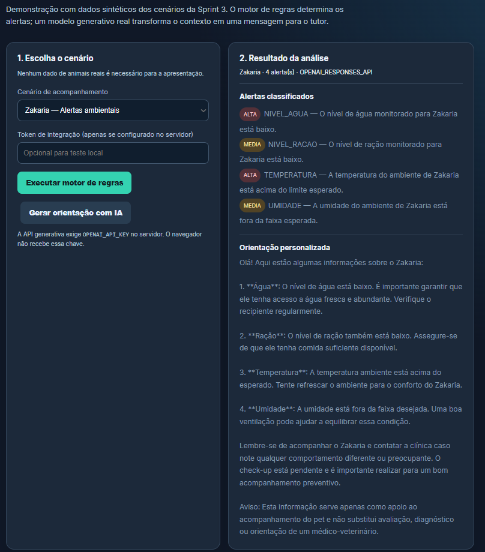
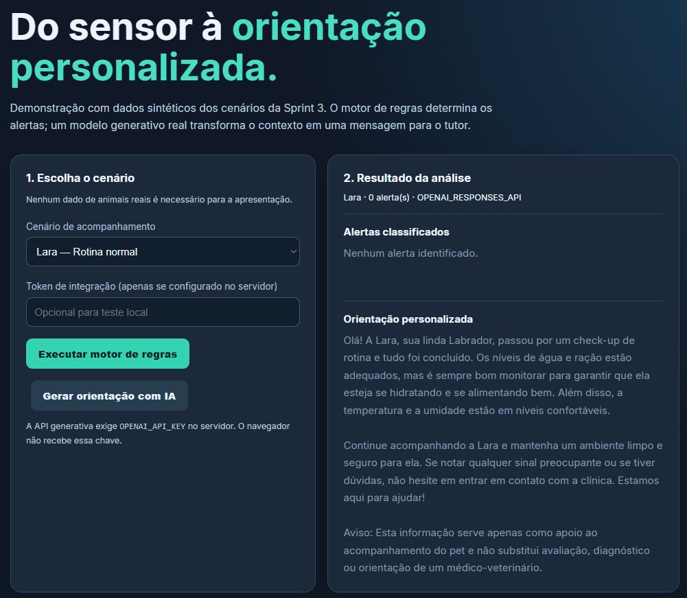
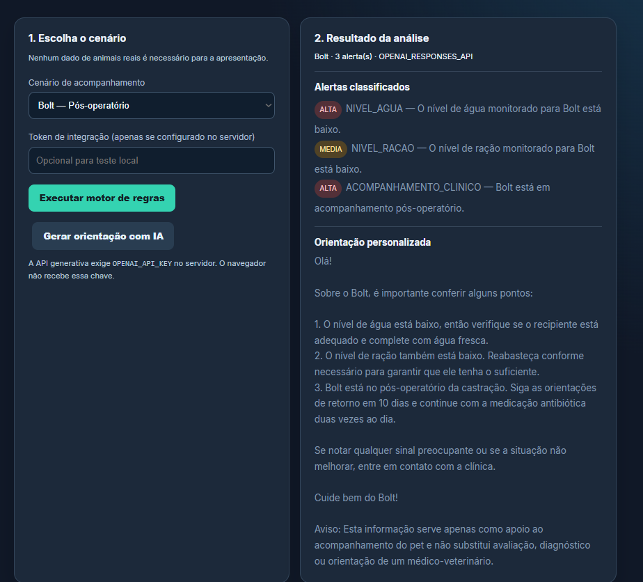

# Evidências da integração generativa — Sprint 4

## Validação local em 02/11/2026

**Ambiente observado:** Windows, Python 3.12.3, FastAPI/Uvicorn local em `127.0.0.1:8000`. A integração com OpenAI Responses API foi identificada na interface como `OPENAI_RESPONSES_API`. Os dados eram JSONs sintéticos; nenhum prontuário real foi utilizado.

| Cenário | Entrada | Alertas previstos e observados | Orientação real | Evidência |
|---|---|---|---|---|
| Zakaria — alertas ambientais | Água 12%, ração 8%, 32 °C, umidade 78% | **4**: água ALTA, ração MÉDIA, temperatura ALTA, umidade MÉDIA | `OPENAI_RESPONSES_API` | [Captura](../evidencias/zakaria-ia-real.png) |
| Lara — rotina normal | Água 75%, ração 65%, 24 °C, umidade 50% | **0** | Preventiva, `OPENAI_RESPONSES_API` | [Captura](../evidencias/lara-ia-real.png) |
| Bolt — pós-operatório | Água 18%, ração 6,5%, 29,5 °C, umidade 55%; evento `POS_OPERATORIO` | **3**: água ALTA, ração MÉDIA, evento clínico ALTA | Contextualizada ao pós-operatório, `OPENAI_RESPONSES_API` | [Captura](../evidencias/bolt-ia-real.png) |

### Registros visuais da execução local

**Zakaria**

**Lara**

**Bolt**

**Testes na validação original:** houve registro de `10 passed, 1 warning` no computador do aluno; depois, a suíte de revisão foi ampliada e houve registro de **21 testes aprovados**. Os testes de contrato com LLM usam mocks, não chamadas pagas. A evidência da IA real é independente desses testes. Os limites do motor são didáticos e não consistem em diagnóstico veterinário.

## Atualização em 03–04/11/2026 — integração Java em produção

Posteriormente, o serviço Python e o painel Java foram publicados em contas Render distintas e ligados por HTTPS com token entre backends. Os testes realizados na interface Java para o pet **Pipoca** apresentaram os seguintes resultados:

| Condições | Resultado observado no Java |
|---|---|
| Água 75%, ração 65%, temperatura 24 °C, umidade 50% | 0 alertas e orientação preventiva contextualizada com `OPENAI_RESPONSES_API` |
| Água 5%, ração 15%, temperatura 34 °C, umidade 50% | 2 alertas de prioridade ALTA e orientação contextualizada com `OPENAI_RESPONSES_API` |

- Serviço Python: https://clyvo-elo-ai-python.onrender.com
- Painel Java: https://clyvo-elo-java.onrender.com
- Vídeo Sprint 4: https://youtu.be/6hMTqWkoWbM
- [Contrato e arquitetura do fluxo Java](integracao-java.md)

**Distinção da prova:** as capturas anteriores mostram apenas a execução local em 02/11; as observações de 03–04/11 comprovam um teste integrado posterior, mas suas capturas específicas ainda precisam ser incluídas no repositório se exigidas como material independente. O protótipo utiliza leituras sintéticas, sem telemetria física ou persistência de leituras no serviço Python.
